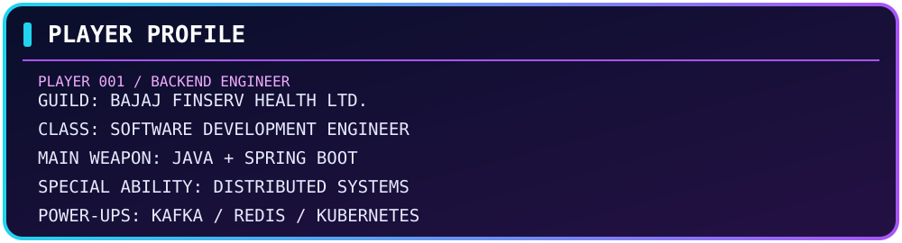
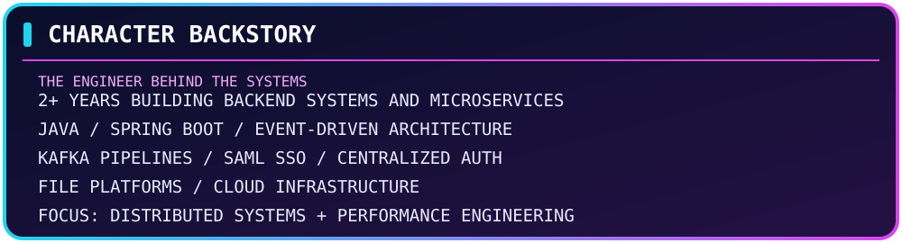
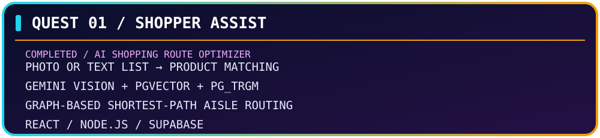
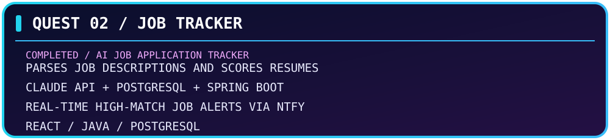

<h1>ARYAMAN SWAMI</h1>
<h3>SOFTWARE DEVELOPMENT ENGINEER</h3>

<b>Building scalable systems, one service at a time.</b>

  

<table align="center" width="96%" cellpadding="12">
<tr>
<td align="center" bgcolor="#17143B">
<b>CURRENT GUILD</b> 
Bajaj Finserv Health Ltd.
</td>
<td align="center" bgcolor="#102B4A">
<b>PRIMARY CLASS</b> 
Backend Engineering
</td>
<td align="center" bgcolor="#351442">
<b>REGION</b> 
India
</td>
</tr>
</table>▰ CHARACTER BACKSTORY

  

<table align="center" width="96%" cellpadding="14">
<tr>
<td bgcolor="#17143B">

I'm a Software Development Engineer with <b>2+ years of experience</b> building backend systems and distributed microservices for production environments.

My work revolves around <b>Java, Spring Boot, event-driven architecture, and cloud infrastructure</b>. I've built high-throughput Kafka pipelines, enterprise SAML SSO integrations, centralized authentication, and file management platforms serving multiple portals.

<b>CURRENTLY INTERESTED IN</b> 
Distributed Systems · Low-Latency Architecture · System Design · Performance Engineering

</td>
</tr>
</table>▰ SKILL TREE

<b>OPEN COMPLETE TECHNOLOGY INVENTORY</b>
Category	Technologies
Languages	Java, JavaScript, TypeScript, SQL
Backend	Spring Boot, Spring Security, Node.js, Express.js, NestJS
Identity	OAuth2/OIDC, SAML 2.0, JWT
Messaging	Apache Kafka, Azure Service Bus
Databases	PostgreSQL, Oracle, MongoDB, Redis
Cloud & DevOps	Azure, AWS, Docker, Kubernetes, Helm, CI/CD
Engineering	DSA, OOP, Concurrency, System Design, Design Patterns
Monitoring	ELK Stack, Grafana

▰ QUEST LOG — COMPLETED PROJECTS
<table align="center" width="96%" cellpadding="14">
<tr>
<td bgcolor="#21133D">

<b>MISSION:</b> Turns a photo or text shopping list into an optimal in-store route using Gemini Vision, hybrid semantic/lexical SKU matching, and graph-based shortest-path routing.

<a href="https://github.com/Aryaman-Swami/Shopper-assist"><b>↗ VIEW SHOPPER ASSIST REPOSITORY</b></a>
</td>
</tr>
<tr>
<td bgcolor="#111F42">

<b>MISSION:</b> Tracks job applications, parses descriptions, scores resume compatibility using Claude API, ranks opportunities, and sends real-time alerts for high-match jobs through ntfy.

<a href="https://github.com/Aryaman-Swami/Job-Tracker"><b>↗ VIEW JOB TRACKER REPOSITORY</b></a>
</td>
</tr>
</table>▰ ACHIEVEMENTS UNLOCKED
<table align="center" width="96%" cellpadding="10">
<tr><td bgcolor="#251744"><b>EVENT ARCHITECT</b></td><td bgcolor="#17143B">Increased event processing throughput 3× to <b>1,000 TPM</b> using Kafka.</td></tr>
<tr><td bgcolor="#102B4A"><b>IDENTITY ARCHITECT</b></td><td bgcolor="#17143B">Onboarded <b>15+ enterprise partners</b> onto SAML 2.0 SSO.</td></tr>
<tr><td bgcolor="#251744"><b>STORAGE ENGINEER</b></td><td bgcolor="#17143B">Built a file management service handling <b>200K+ daily transactions</b> at sub-100ms p99 API latency.</td></tr>
<tr><td bgcolor="#102B4A"><b>MIGRATION ENGINEER</b></td><td bgcolor="#17143B">Modernized <b>4 legacy portals</b> from Java 8 to Java 25.</td></tr>
<tr><td bgcolor="#251744"><b>PERFORMANCE OPTIMIZER</b></td><td bgcolor="#17143B">Reduced heap memory by <b>60%</b> — from 3 GB to 1.2 GB.</td></tr>
<tr><td bgcolor="#102B4A"><b>PAYMENT AUTOMATION</b></td><td bgcolor="#17143B">Cut verification time by <b>85%+</b> — from 20 minutes to under 3 minutes — supporting 500+ daily onboarding requests.</td></tr>
</table>▰ PLAYER CONNECTIONS

  
<b>✦ MORE QUESTS COMING SOON... ✦</b>

