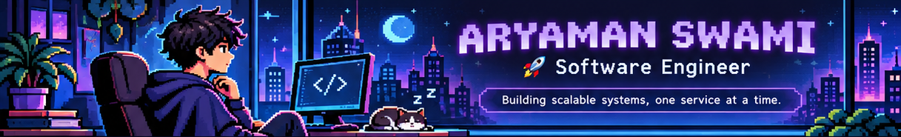
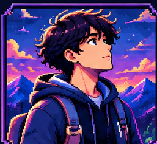
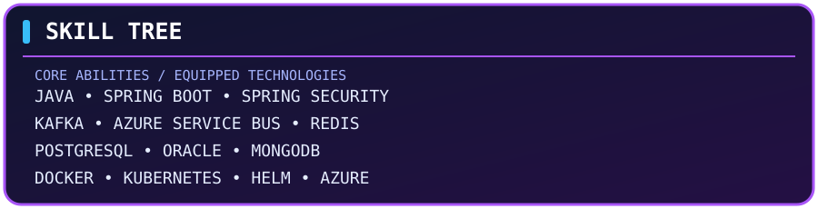

  

<h2 align="center">✦ PLAYER PROFILE ✦</h2>

<table align="center" width="92%" cellpadding="14" bgcolor="#11102B">
  <tr>
    <td align="center" width="34%" bgcolor="#211044">
      
      <h3>ARYAMAN SWAMI</h3>
      
<b>PLAYER 001</b>

      
<b>BACKEND ENGINEER</b>

      

        
        
      

    </td>
    <td align="center" valign="middle" bgcolor="#171735">
      <h3>PLAYER STATS</h3>
      <table align="center" width="100%" cellpadding="9">
        <tr bgcolor="#29204B"><td><b>GUILD</b></td><td>Bajaj Finserv Health Ltd.</td></tr>
        <tr bgcolor="#1C2447"><td><b>CLASS</b></td><td>Software Development Engineer</td></tr>
        <tr bgcolor="#29204B"><td><b>MAIN WEAPON</b></td><td>Java · Spring Boot</td></tr>
        <tr bgcolor="#1C2447"><td><b>SPECIAL ABILITY</b></td><td>Distributed Systems</td></tr>
        <tr bgcolor="#29204B"><td><b>POWER-UPS</b></td><td>Kafka · Redis · Kubernetes</td></tr>
        <tr bgcolor="#1C2447"><td><b>CURRENT FOCUS</b></td><td>Scalability &amp; System Design</td></tr>
      </table>
    </td>
  </tr>
</table>

 

<h2 align="center">📜 CHARACTER BACKSTORY</h2>

<table align="center" width="92%" cellpadding="16" bgcolor="#17132F">
  <tr>
    <td>
      
<b>THE ENGINEER BEHIND THE SYSTEMS</b>

      

        
          I'm a Software Development Engineer with <b>2+ years of experience</b> building backend systems and distributed microservices for production environments.
        
      

      

        
          My work revolves around <b>Java, Spring Boot, event-driven architecture, and cloud infrastructure</b>. I've built high-throughput Kafka pipelines, enterprise SAML SSO integrations, centralized authentication, and file management platforms serving multiple portals.
        
      

      

        <b>CURRENTLY EXPLORING</b> 
        Distributed Systems&nbsp; · &nbsp;Low-Latency Architecture&nbsp; · &nbsp;System Design&nbsp; · &nbsp;Performance Engineering
      

    </td>
  </tr>
</table>

 

<h2 align="center">🌳 SKILL TREE</h2>

  

<b>Open complete technology inventory</b>

| Category | Technologies |
|---|---|
| Languages | Java, JavaScript, TypeScript, SQL |
| Backend | Spring Boot, Spring Security, Node.js, Express.js, NestJS |
| Identity | OAuth2/OIDC, SAML 2.0, JWT |
| Messaging | Apache Kafka, Azure Service Bus |
| Databases | PostgreSQL, Oracle, MongoDB, Redis |
| Cloud & DevOps | Azure, AWS, Docker, Kubernetes, Helm, CI/CD |
| Engineering | DSA, OOP, concurrency, system design, design patterns |
| Monitoring | ELK Stack, Grafana |

 

<h2 align="center">⚔️ QUEST LOG — COMPLETED PROJECTS</h2>

<table align="center" width="92%" cellpadding="16" bgcolor="#17132F">
  <tr>
    <td>
      <h3>QUEST 01 — SHOPPER ASSIST [COMPLETED]</h3>
      
AI-powered shopping assistant that turns a photo or text shopping list into an optimal in-store route.

      
React · Node.js · Supabase · pgvector · Gemini

      <a href="https://github.com/Aryaman-Swami/Shopper-assist">↗ VIEW QUEST REPOSITORY</a>
    </td>
  </tr>
  <tr>
    <td bgcolor="#21183D">
      <h3>QUEST 02 — JOB TRACKER [COMPLETED]</h3>
      
AI-powered job application tracker that parses job descriptions, scores them against my resume, ranks opportunities, and sends real-time alerts through ntfy.

      
React · Java · Spring Boot · PostgreSQL · Claude API

      <a href="https://github.com/Aryaman-Swami/Job-Tracker">↗ VIEW QUEST REPOSITORY</a>
    </td>
  </tr>
</table>

 

<h2 align="center">🏆 ACHIEVEMENTS UNLOCKED</h2>

  

| Achievement | Engineering Impact |
|---|---|
| Event Architect | Increased event processing throughput 3× to 1,000 TPM using Kafka. |
| Identity Architect | Onboarded 15+ enterprise partners onto SAML 2.0 SSO. |
| Storage Engineer | Built a file management service handling 200K+ daily transactions at sub-100ms p99 API latency. |
| Migration Engineer | Modernized 4 legacy portals from Java 8 to Java 25. |
| Performance Optimizer | Reduced heap memory by 60% — from 3 GB to 1.2 GB. |
| Payment Automation | Cut verification time by 85%+ — from 20 minutes to under 3 minutes — supporting 500+ daily onboarding requests. |

<h2 align="center">🌌 PLAYER CONNECTIONS</h2>

  
  
  
    
  <b>✦ MORE QUESTS COMING SOON... ✦</b>

