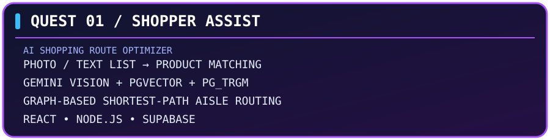
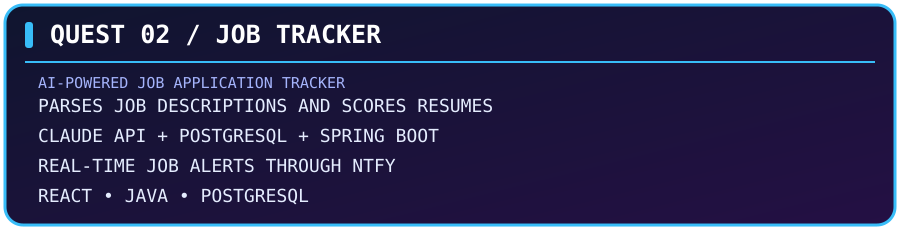

<h2>PLAYER ONE · BACKEND ENGINEER</h2>

<b>Building scalable systems, one service at a time.</b>

<a href="https://github.com/Aryaman-Swami">GITHUB</a> ·
<a href="https://linkedin.com/in/aryaman-swami">LINKEDIN</a> ·
<a href="mailto:swamiaryaman21.as@gmail.com">EMAIL</a>

---

<table>
<tr>
<td width="28%" align="center" valign="middle">

**PLAYER 001**

`BACKEND ENGINEER`

</td>
<td width="72%" valign="middle">

### ARYAMAN SWAMI

**Software Development Engineer**

`LEVEL 02+` · `SYSTEM BUILDER` · `INDIA`

| PLAYER ATTRIBUTE | STATUS |
|:--|:--|
| Current Guild | Bajaj Finserv Health Ltd. |
| Primary Class | Backend Engineering |
| Main Weapon | Java & Spring Boot |
| Special Ability | Distributed Systems |
| Power-ups | Kafka · Redis · Kubernetes |
| Current Focus | Scalability & System Design |

</td>
</tr>
</table>

### ◈ CHARACTER BACKSTORY

I'm a Software Development Engineer with **2+ years of experience** building backend systems and distributed microservices for production environments.

My work revolves around **Java, Spring Boot, event-driven architecture, and cloud infrastructure**. I've worked on high-throughput Kafka pipelines, enterprise SAML SSO integrations, centralized authentication, and file management platforms serving multiple portals.

I enjoy engineering systems that are scalable, reliable, and efficient — understanding not just how to build a service, but how it behaves under real-world load.

**Currently interested in:** Distributed Systems · Low-Latency Architecture · System Design · Performance Engineering

## 01 / SKILL TREE

<b>Open complete technology inventory</b>

| Category | Technologies |
|---|---|
| Languages | Java, JavaScript, TypeScript, SQL |
| Backend | Spring Boot, Spring Security, Node.js, Express.js, NestJS |
| Identity | OAuth2/OIDC, SAML 2.0, JWT |
| Messaging | Apache Kafka, Azure Service Bus |
| Databases | PostgreSQL, Oracle, MongoDB, Redis |
| Cloud & DevOps | Azure, AWS, Docker, Kubernetes, Helm, CI/CD |
| Engineering | DSA, OOP, concurrency, system design, design patterns |
| Monitoring | ELK Stack, Grafana |

## 02 / QUEST LOG

<table>
<tr>
<td width="50%" valign="top">

Turns a photo or text shopping list into an optimized in-store route using Gemini Vision, hybrid semantic/lexical SKU matching, and graph-based shortest-path routing.

<code>React</code> <code>Node.js</code> <code>Supabase</code> <code>pgvector</code> <code>Gemini</code>

<a href="https://github.com/Aryaman-Swami/Shopper-assist"><b>↗ EXPLORE QUEST</b></a>

</td>
<td width="50%" valign="top">

Tracks applications, parses job descriptions, scores resume compatibility with Claude API, and sends real-time alerts for newly discovered high-match roles through ntfy.

<code>React</code> <code>Java</code> <code>Spring Boot</code> <code>PostgreSQL</code> <code>Claude API</code>

<a href="https://github.com/Aryaman-Swami/Job-Tracker"><b>↗ EXPLORE QUEST</b></a>

</td>
</tr>
</table>

## 03 / ACHIEVEMENTS UNLOCKED

| Achievement | Impact |
|---|---|
| Event Architect | Increased event processing throughput 3× to 1,000 TPM using Kafka. |
| Identity Architect | Onboarded 15+ enterprise partners onto SAML 2.0 SSO. |
| Storage Engineer | Built a file management service handling 200K+ daily transactions at sub-100ms p99 API latency. |
| Migration Engineer | Modernized 4 legacy portals from Java 8 to Java 25. |
| Performance Optimizer | Reduced heap memory by 60% — from 3 GB to 1.2 GB. |
| Payment Automation | Cut verification time by 85%+ — from 20 minutes to under 3 minutes — supporting 500+ daily onboarding requests. |

## 04 / CURRENT MISSIONS
- [x] Build and operate scalable backend services
- [x] Work with event-driven and distributed architectures
- [ ] Deepen system design and distributed systems expertise
- [ ] Explore AI-powered product experiences
- [ ] Improve performance engineering and reliability

## 05 / PLAYER CONNECTIONS

  ✦ THANKS FOR VISITING ✦ 
<b>Let's build something meaningful together.</b>

