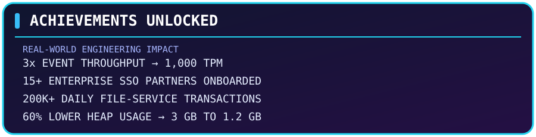

<h1>ARYAMAN SWAMI</h1>
<h3>SOFTWARE DEVELOPMENT ENGINEER</h3>

<b>Building scalable systems, one service at a time.</b>

 

 

<table align="center" width="96%" border="0" cellpadding="14" cellspacing="10">
<tr>
<td align="center" width="33%" bgcolor="#17143B">
<b>◆ CURRENT GUILD</b>  
Bajaj Finserv Health Ltd.
</td>
<td align="center" width="33%" bgcolor="#102B4A">
<b>◆ PRIMARY CLASS</b>  
Backend Engineering
</td>
<td align="center" width="33%" bgcolor="#351442">
<b>◆ REGION</b>  
India
</td>
</tr>
</table>

 

<h2 align="center">▰ CHARACTER BACKSTORY</h2>

 

<table align="center" width="96%" border="1" bordercolor="#7137A8" cellpadding="18" cellspacing="0">
<tr>
<td bgcolor="#17132F">

I'm a Software Development Engineer with <b>2+ years of experience</b> building backend systems and distributed microservices for production environments.

My work revolves around <b>Java, Spring Boot, event-driven architecture, and cloud infrastructure</b>. I've built high-throughput Kafka pipelines, enterprise SAML SSO integrations, centralized authentication, and file management platforms serving multiple portals.

<b>▸ CURRENTLY INTERESTED IN</b>

<b>Distributed Systems</b> &nbsp; ◆ &nbsp;
<b>Low-Latency Architecture</b> &nbsp; ◆ &nbsp;
<b>System Design</b> &nbsp; ◆ &nbsp;
<b>Performance Engineering</b>

</td>
</tr>
</table>

 

<h2 align="center">▰ SKILL TREE</h2>

  

  

 

<b>＋ OPEN COMPLETE TECHNOLOGY INVENTORY</b>

 

| Category | Technologies |
|---|---|
| Languages | Java, JavaScript, TypeScript, SQL |
| Backend | Spring Boot, Spring Security, Node.js, Express.js, NestJS |
| Identity | OAuth2/OIDC, SAML 2.0, JWT |
| Messaging | Apache Kafka, Azure Service Bus |
| Databases | PostgreSQL, Oracle, MongoDB, Redis |
| Cloud & DevOps | Azure, AWS, Docker, Kubernetes, Helm, CI/CD |
| Engineering | DSA, OOP, Concurrency, System Design, Design Patterns |
| Monitoring | ELK Stack, Grafana |

 

<h2 align="center">▰ QUEST LOG — COMPLETED PROJECTS</h2>

<table align="center" width="96%" border="0" cellpadding="18" cellspacing="12">
<tr>
<td bgcolor="#21133D">

  
<b>MISSION BRIEF</b>

Turns a photo or text shopping list into an optimal in-store route using Gemini Vision, hybrid semantic/lexical SKU matching, and graph-based shortest-path routing.

<a href="https://github.com/Aryaman-Swami/Shopper-assist"><b>↗ VIEW SHOPPER ASSIST REPOSITORY</b></a>
</td>
</tr>
<tr>
<td bgcolor="#111F42">

  
<b>MISSION BRIEF</b>

Tracks job applications, parses descriptions, scores resume compatibility using Claude API, ranks opportunities, and sends real-time alerts for high-match jobs through ntfy.

<a href="https://github.com/Aryaman-Swami/Job-Tracker"><b>↗ VIEW JOB TRACKER REPOSITORY</b></a>
</td>
</tr>
</table>

 

<h2 align="center">▰ ACHIEVEMENTS UNLOCKED</h2>

 

<table align="center" width="96%" border="0" cellpadding="12" cellspacing="8">
<tr><td bgcolor="#251744" width="28%"><b>EVENT ARCHITECT</b></td><td bgcolor="#17143B">Increased event processing throughput 3× to <b>1,000 TPM</b> using Kafka.</td></tr>
<tr><td bgcolor="#102B4A"><b>IDENTITY ARCHITECT</b></td><td bgcolor="#17143B">Onboarded <b>15+ enterprise partners</b> onto SAML 2.0 SSO.</td></tr>
<tr><td bgcolor="#251744"><b>STORAGE ENGINEER</b></td><td bgcolor="#17143B">Built a file management service handling <b>200K+ daily transactions</b> at sub-100ms p99 API latency.</td></tr>
<tr><td bgcolor="#102B4A"><b>MIGRATION ENGINEER</b></td><td bgcolor="#17143B">Modernized <b>4 legacy portals</b> from Java 8 to Java 25.</td></tr>
<tr><td bgcolor="#251744"><b>PERFORMANCE OPTIMIZER</b></td><td bgcolor="#17143B">Reduced heap memory by <b>60%</b> — from 3 GB to 1.2 GB.</td></tr>
<tr><td bgcolor="#102B4A"><b>PAYMENT AUTOMATION</b></td><td bgcolor="#17143B">Cut verification time by <b>85%+</b> — from 20 minutes to under 3 minutes — supporting 500+ daily onboarding requests.</td></tr>
</table>

 

<h2 align="center">▰ PLAYER CONNECTIONS</h2>

  
<b>✦ MORE QUESTS COMING SOON... ✦</b>

